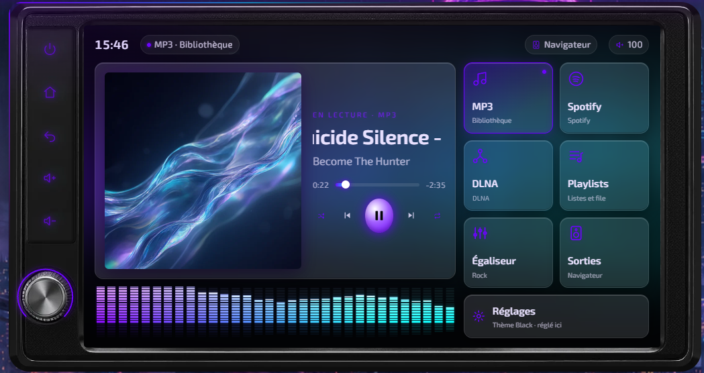
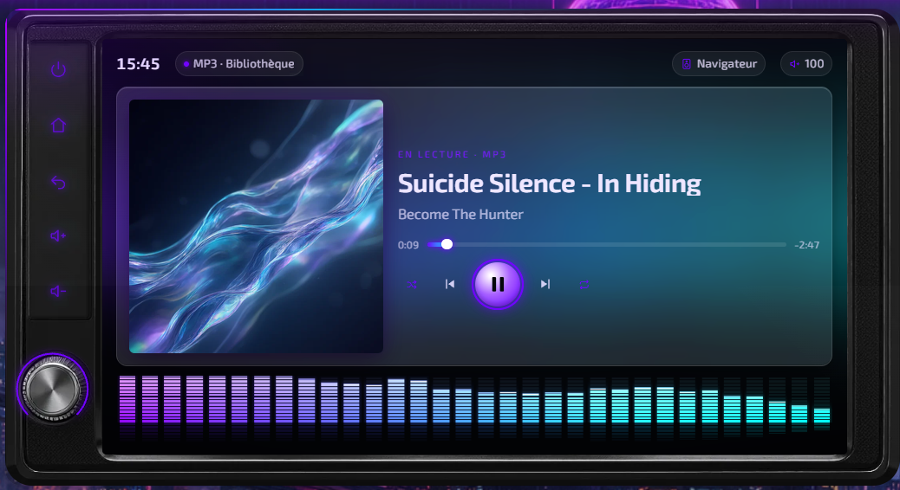
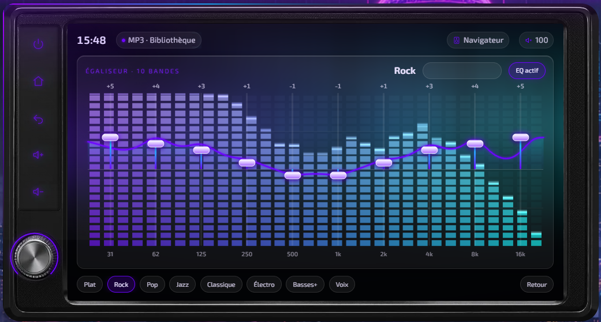
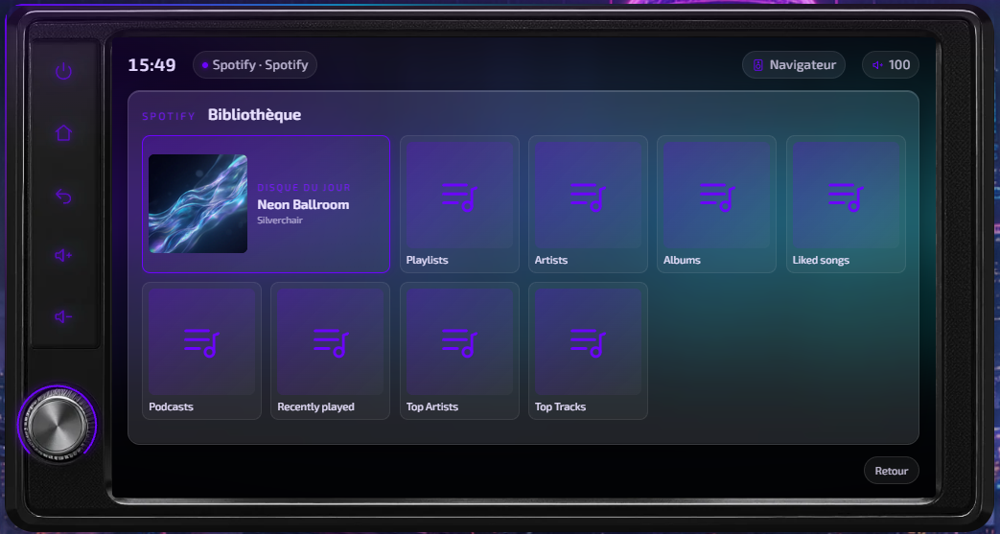
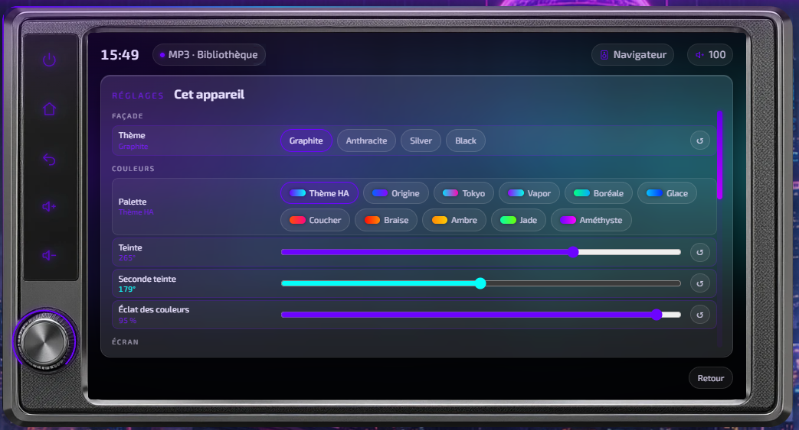

<div align="center">

# Neon Media Card

**A neon music player card for Home Assistant, built like a double-DIN car stereo: your local music library, DLNA and Spotify behind one faceplate, with a WebGL spectrum and a 10-band equalizer.**

[![HACS Custom][hacs-badge]][hacs-url]
[![Release][release-badge]][release-url]
[![Validate][validate-badge]][validate-url]
[![License: MIT][license-badge]][license-url]

[](https://my.home-assistant.io/redirect/hacs_repository/?owner=cerealkiller57540&repository=neon-media-card&category=plugin)



</div>

The card plays your files **in the browser itself**, through Web Audio: the equalizer, the spectrum and the crossfade work on the real signal, not on a picture of it. When you would rather hear it on a speaker, the Outputs page hands playback to any `media_player`.

<p>
  
  
</p>
<p>
  
  
</p>

*The screenshots show the French interface. The card follows your Home Assistant language: French or English.*

## ✨ Features

- **Four sources**: a media folder (`media-source`, e.g. `/media`), a DLNA server, Spotify, and web radio.
- **Large libraries**: with the optional index script, the whole library loads in one request (tested with about 30,000 tracks). Without it, the card browses folder by folder.
- **Cover art** from the file tags (ID3 and FLAC), then the folder image, then, optionally, Discogs.
- **10-band equalizer** on the actual audio: 8 built-in presets, a draggable curve, a live spectrum behind it, and foobar2000 `.feq` presets if you drop some in a folder.
- **Crossfade** between tracks (0 to 12 s).
- **Playlists** saved in Home Assistant, so every device sees the same lists, plus a sortable play queue and search.
- **Spotify**: browse your library (playlists, artists, albums, liked songs, podcasts, recently played, top artists and tracks), pick the Spotify Connect device, and play an "album of the day" from any sensor holding a `spotify:` link.
- **Web radio**: favourites, search, and browsing by country, genre and language, most listened first, through the public [Radio Browser](https://www.radio-browser.info) directory. A live stream has no seek bar and no crossfade, and reconnects by itself after a drop. The favourites start with four Radio France stations; the star adds or removes a station.
- **Outputs**: this browser (with the audio output device on Chrome and Edge), or any `media_player`. Players with their own queue (Sonos) get the next tracks in advance and keep playing with the card closed; the others are fed track by track.
- **Four faceplates** (graphite, anthracite, silver, black), ten colour palettes or your Home Assistant theme colours, two blended hues, glow, glass and text size.
- **Living screen**: the aurora follows the bass of the music played in the browser, the screen collapses like a CRT tube on power off, the volume knob turns with its ring, covers cross-fade, a tap on the cover shows it full screen, and a live radio stream gets a sweeping progress bar. Everything calms down with the system's reduced-motion setting.
- **Per-device settings**: the Settings page stores its choices in the browser, so the wall tablet and the phone can each have their own look over the same card.
- **Hardware media keys** and the lock-screen controls (Media Session).
- **Visual editor**, with no YAML needed. English and French.
- Respects `prefers-reduced-motion`.

## 📦 Installation

### HACS (recommended)

1. Click the **Open in HACS** button above, or add this repository as a custom repository in HACS (category **Dashboard**): `https://github.com/cerealkiller57540/neon-media-card`.
2. Download **Neon Media Card**.
3. Reload your browser.

HACS registers one resource, `neon-media-card.js`. The faceplates, fonts and helper modules next to it are loaded by the card itself. The card type is `custom:neon-media-card`. Until version 0.16 the card was called *Autoradio Card* (`custom:autoradio-card`): that type still works, so existing dashboards need no change.

### Manual

1. Copy every file of [`dist/`](dist/) to `config/www/neon-media-card/`.
2. Add a dashboard resource: URL `/local/neon-media-card/neon-media-card.js`, type **JavaScript module**.

## 🚀 Usage

Add a card from the dashboard editor and search for **Neon Media**, or use YAML:

```yaml
type: custom:neon-media-card
entity: media_player.spotify_me              # optional: the Spotify integration's player
media_folder: media-source://media_source/local
outputs:                                     # optional: players offered on the Outputs page
  - media_player.living_room
  - media_player.kitchen
```

The card is wide by design (a car stereo is about 2:1). It fits best in a full-width section or a panel view.

## ⚙️ Options

| Option | Type | Default | Description |
|---|---|---|---|
| `entity` | string | — | Spotify `media_player` from the Spotify integration. Without it, the Spotify tile stays empty |
| `source` | string | first device | Spotify Connect device to wake up when Spotify is idle |
| `album_entity` | string | — | Sensor whose state is a `spotify:` link (album, playlist, artist or track), shown as the album of the day |
| `outputs` | list | — | `media_player` entities offered on the Outputs page |
| `media_folder` | string | `media-source://media_source/local` | Root of the MP3 source |
| `dlna_folder` | string | `media-source://dlna_dms` | Root of the DLNA source |
| `index_url` | string | `/local/neon-media-card/index.json` | Library index written by the index script. The default matches where the script writes it, with HACS or a manual install |
| `eq_folder` | string | `/local/neon-media-card/eq/` | Folder of `.feq` presets, listed by an `index.json` written by the index script |
| `theme` | string | `graphite` | Faceplate: `graphite`, `anthracite`, `silver`, `black` |
| `font` | string | `system` | Screen font: `system`, `orbitron`, `exo2`, `saira`, `oxanium`, `jura`, `sharetechmono` |
| `palette_ha` | bool | `false` | Use the Home Assistant theme colours instead of the hues |
| `hue` / `hue2` | number | `217` / `hue + 55` | The two hues blended across the screen (0–360) |
| `vivid` | number | `0` | `0` = original pastel, `1` = pure colour |
| `glow` | number | `0.8` | Glow (0–1.5) |
| `glass` / `blur` | number | `0.12` / `18` | Glass opacity (0–0.4) and blur in px (0–40) |
| `aurora` | number | `0.6` | Background aurora (0–1.5) |
| `text` | number | `1.0` | Text size (0.7–1.4) |
| `tiles_hide` | number | `15` | Fold the tiles after this many seconds without a gesture (`0` = never) |
| `crossfade` | number | `4` | Crossfade between tracks, in seconds (`0` = cut) |
| `eq_curve_glow`, `eq_fill`, `eq_spec`, `eq_thumb`, `eq_q` | number | `1.0`, `0.18`, `0.55`, `1.0`, `1.4` | Equalizer look: curve glow, fill under the curve, spectrum behind the curve, handle size, band width (Q) |

Everything on the **Settings** page of the card (faceplate, font, palette, hues, glow, glass, text size, tile folding, crossfade) can also be changed there, on each device. Those choices win over the card configuration on that device; each one has a reset button.

## 🧩 Optional server-side helpers (pyscript)

The card works on its own. Three [pyscript](https://github.com/custom-components/pyscript) services, in the [`pyscript/`](pyscript/) folder, add what a browser cannot do alone. Copy the ones you want to `config/pyscript/`; the card detects each service and simply skips it when it is missing.

| Script | Service | What it adds |
|---|---|---|
| `neon_media_index.py` | `pyscript.neon_media_index` | Walks `/media` on the server every night (and at start-up) and writes `www/neon-media-card/index.json`, gzipped. Without it, the browser can only list one folder at a time, which caps the MP3 source at about 80 folders and 1,000 tracks. It also writes the list of `.feq` presets in `www/neon-media-card/eq/`. |
| `neon_media_playlists.py` | `pyscript.neon_media_playlists` | Stores the playlists and the radio favourites in `config/neon_media_playlists.json`, shared by every device. A device writing over a list changed elsewhere gets the newer version instead of overwriting it. Without it, there are no saved playlists, only the play queue, and each browser keeps its own radio favourites. |
| `neon_media_cover.py` | `pyscript.neon_media_cover` | Last-resort cover art from Discogs, for tracks with no embedded or folder image. It needs the [Discogs integration](https://www.home-assistant.io/integrations/discogs/) and uses its token, server-side only; without it, the script does nothing and the card keeps its default cover. Results are cached in `config/neon_media_covers.json`. |

## ❓ FAQ

**Which languages are supported?** English and French. The editor and the card texts follow your Home Assistant language: French if it is French, English otherwise. Reload the page after changing the language.

**Which audio formats play?** Whatever the browser decodes: MP3, FLAC, Ogg/Opus, M4A/AAC, WAV and WebM in Chrome, Edge and Firefox. Safari does not play Ogg in every version.

**The music stops when I leave the view.** The audio lives in the browser tab. Switching views keeps it playing (the card picks up the running track when it comes back); closing the tab or the Home Assistant app stops it. For playback that survives, send it to a speaker from the Outputs page.

**The music stops after a while when the tab is in the background.** Home Assistant closes its connection once a tab has been hidden for 5 minutes (profile setting *Suspend background connections*). Since 0.17.1 the browser output keeps going through the next 30 tracks, prepared in advance; past them, it waits and picks up again by itself when you come back to the tab. A player fed track by track stops at the end of its current track. To keep the connection open, turn that setting off in your Home Assistant profile; it is stored per browser.

**The MP3 source only shows part of my library.** Install `neon_media_index.py` (see above); the card finds its index without any setting.

**Can I choose the audio output device?** On Chrome and Edge, yes, from the Outputs page. Safari and Firefox do not let a page pick the output of Web Audio.

**Where do the `.feq` presets come from?** From foobar2000's equalizer (18 bands, brought back to 10). None is shipped: drop your own in the `eq_folder` and let the index script list them.

**Some stations do not play, or play without the equalizer.** The browser plays each stream straight from the station's server. The equalizer and the real spectrum need that server to allow it (CORS); when it does not, the station still plays, untouched, with a simulated spectrum. On a Home Assistant served over HTTPS, the browser refuses plain `http://` streams: the card tries the same address over `https://`, and a station without HTTPS cannot play in that browser, only on a player from the Outputs page. HLS streams (greyed out) play only in browsers that read HLS natively, such as Safari, or on a player.

**Do I need the Radio Browser integration of Home Assistant?** No. Search and browsing call the Radio Browser API from the browser. When the integration is installed, a station sent to a player goes through it (`media-source://radio_browser/…`) rather than as a bare stream address.

## 🔤 Fonts and privacy

The six optional screen fonts (Orbitron, Exo 2, Saira, Oxanium, Jura, Share Tech Mono) are shipped next to the card as `font-*.woff2` files (Latin subset, unmodified from Google Fonts), and a font is only downloaded from your own Home Assistant when you pick it: the card makes **no request to Google Fonts**. Discogs is only contacted by the optional cover script, from your server. The fonts are licensed under the SIL Open Font License 1.1, see [NOTICE.md](NOTICE.md).

The radio is the only part of the card that talks to third-party servers, from your browser: search and browsing call the public [Radio Browser](https://www.radio-browser.info) API (`all.api.radio-browser.info`, which receives the search terms or the list opened), country flags come from `flagcdn.com`, station logos from each station's website, and the stream from the station's server. These requests send no referrer, and none of them happens until you select the Radio source.

## 🌃 More neon cards

## 🧱 How this repository is built

`dist/neon-media-card.js` is the file HACS installs. It is built from the version running on the author's own Home Assistant: personal defaults are replaced with neutral ones, the version number is stamped, and the build stops if a local IP address or a token is found. That working copy is not published; bugs and suggestions are welcome as issues.

This card is part of a family. See the full collection at [**Home-Assistant-Neon-Cards**](https://github.com/cerealkiller57540/Home-Assistant-Neon-Cards).

---

## 🐾 Support this project

If you enjoy these cards, please consider donating to **Quatre Pattes**, an animal rescue organization.

[](https://www.four-paws.org/)

> 💛 No need to support me — just help the animals. Thank you!

---

## 🤝 Contributing

1. Fork the repo
2. Create your branch: `git checkout -b feature/my-card`
3. Commit and push
4. Open a Pull Request

---

## 📄 License

[MIT License][license-url]

[hacs-badge]: https://img.shields.io/badge/HACS-Custom-orange.svg?style=for-the-badge
[hacs-url]: https://hacs.xyz
[release-badge]: https://img.shields.io/github/v/release/cerealkiller57540/neon-media-card?style=for-the-badge
[release-url]: https://github.com/cerealkiller57540/neon-media-card/releases
[validate-badge]: https://img.shields.io/github/actions/workflow/status/cerealkiller57540/neon-media-card/validate.yml?branch=main&label=HACS&style=for-the-badge
[validate-url]: https://github.com/cerealkiller57540/neon-media-card/actions/workflows/validate.yml
[license-badge]: https://img.shields.io/github/license/cerealkiller57540/neon-media-card?style=for-the-badge
[license-url]: LICENSE
